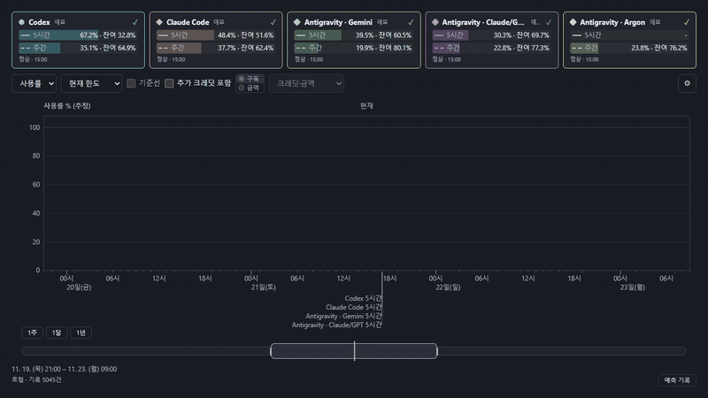
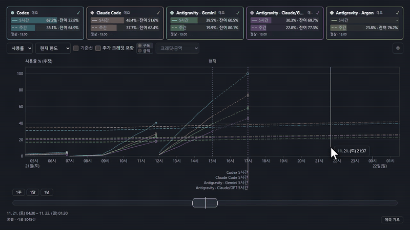
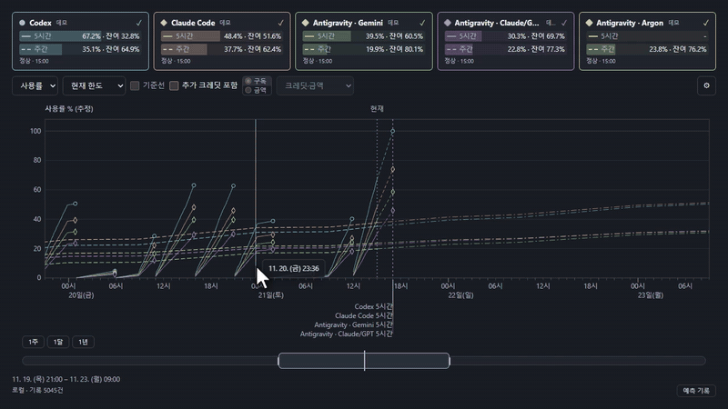
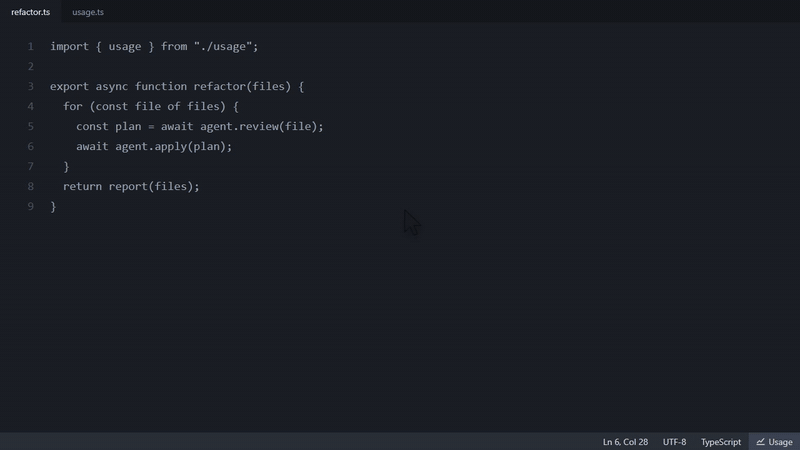
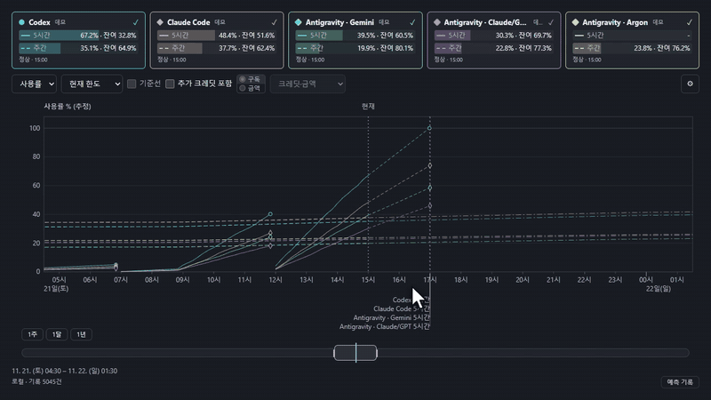

# Usage Atlas

**English summary** — Usage Atlas is a VS Code extension that shows your Codex, Claude Code and Antigravity subscription usage on one screen, predicts when each limit will run out, and compares extra credits where the account exposes them. It works on Windows and WSL, reads your existing official logins (no API keys to enter), and is an independent extension — not an official product of OpenAI, Anthropic or Google. The documentation below is in Korean.

Codex·Claude Code·Antigravity의 구독 사용량과 소진 예측, 확인 가능한 추가 크레딧을 한 화면에서 확인하는 VS Code 확장입니다. Windows와 WSL에서 동작하며 OpenAI·Anthropic·Google의 공식 제품이 아닌 독립 확장입니다.

[다운로드](https://github.com/msmckimgpt-tech/usage-atlas/releases) · [문제 제보](https://github.com/msmckimgpt-tech/usage-atlas/issues) · [개인정보 처리](PRIVACY.md) · [사용 안내](docs/USER-GUIDE.md) · [변경 내역](CHANGELOG.md)

*화면은 합성 데이터로 만든 예시입니다(계정·요금제 «데모»). 실제 기록은 사용하지 않았습니다.*

## 왜 필요한가

작업 한창일 때 5시간 한도나 주간 한도가 바닥나 흐름이 끊긴 적이 있다면, 문제는 «얼마나 남았는지»를 쓰는 도중에는 잘 보이지 않는다는 점입니다. Usage Atlas는 세 가지로 이를 풀어 줍니다.

1. **한눈에** — Codex·Claude Code·Antigravity의 5시간·주간 사용률을 한 그래프에 모아 봅니다.
2. **언제 바닥날지 예상** — 최근 평균과 요일·시간대 패턴으로 구독 100% 도달 시점을 미리 보여 줍니다.
3. **상태 표시줄에서 바로** — 편집기 아래 Usage에 마우스를 올리면 최근 5시간 미리보기가 열립니다.

## 화면 투어

### 소진 예측
예상선 끝의 마커에 마우스를 올리면 «100% 소진 예상» 시각이 나옵니다. 예상은 최근 관측과 과거 패턴이 이어진다는 가정이며 보장이 아닙니다.

### 드래그로 확대
차트를 드래그해 구간을 확대합니다. 중간 버튼 이동, Ctrl+휠 확대·축소, Shift+휠 이동과 하단 날짜 범위 조절기도 지원합니다.

### 상태 표시줄 미리보기
다른 화면에서 작업 중에도 편집기 아래 **Usage**에 마우스를 올리면 모델별 사용률과 소진 예상을 확인합니다.

### 상세 분석
그래프 선을 클릭하면 전체 화면 상세 분석이 열려 프로젝트별 활동 히트맵, 호출·세션 요약, 로컬 대화 내역을 볼 수 있습니다.

이 밖에 사용률·변화량·누적 보기, 모델별 ON/OFF, 추가 크레딧 비교, 밝음·어두움·시스템 테마를 지원합니다. 자세한 기능은 [사용 안내](docs/USER-GUIDE.md)를 참조하세요.

## 설치

1. VS Code 확장 화면(`Ctrl+Shift+X`)에서 **Usage Atlas**를 검색해 **Install**을 누릅니다. 터미널에서는 `code --install-extension msmckimgpt-tech.usage-atlas`로도 설치할 수 있습니다.
2. 명령 팔레트에서 **Usage Atlas: 사용량 그래프 열기**를 실행합니다.
3. Codex·Claude Code·Antigravity에 이미 로그인돼 있으면 별도 설정 없이 기록이 쌓이기 시작합니다. 연결 방식은 아래 [제공자 연결](#제공자-연결)을 참조하세요.

### 다른 방법
- **VSIX**: [Releases](https://github.com/msmckimgpt-tech/usage-atlas/releases)에서 최신 VSIX를 내려받아 확장 화면 메뉴의 **Install from VSIX…**로 설치합니다. 마켓플레이스 반영은 GitHub Releases보다 늦을 수 있어, 최신 버전이 필요하면 이 방법을 쓰세요.
- **WSL**: **Remote - WSL 창에 연결한 상태**에서 설치하고 해당 원격 창의 확장 화면에 설치됐는지 확인하세요. Windows와 WSL은 각각 실행되는 사용자 계정의 공식 로그인과 로컬 기록을 참조하며 기록을 자동 병합하지 않습니다.
- **이전 GitHub 배포판 사용자**: 확장 ID는 `msmckimgpt-tech.usage-atlas`입니다. 이전 배포판(`local-tools.usage-atlas`)에서 업데이트하면 첫 실행 때 이전 기록 폴더를 새 폴더로 한 번 복사하며 이전 폴더는 지우지 않습니다. 이전 확장은 직접 제거하세요. 두 확장을 동시에 켜면 수집이 중복됩니다.

설치 절차의 전체 설명은 [사용 안내](docs/USER-GUIDE.md#설치-상세vsixcliwsl)에 있습니다.

## 제공자 연결

Usage Atlas에 별도 API 키나 비밀번호를 입력하지 않습니다. 계정 상태나 요금제가 제공하지 않는 지표는 `-`로 표시합니다.

| 서비스 | 연결 방식 | 알아둘 점 |
|---|---|---|
| **Codex** | 공식 확장 **Codex - OpenAI’s coding agent**의 실행 파일과 기존 로그인을 우선 사용합니다. | 필요하면 설정에서 Codex 실행 파일 경로를 지정하세요. |
| **Claude** | 기존 Claude Code 로그인을 참조합니다. | 사용량 호환 API는 공개된 고정 계약이 아니므로 제공자 변경이나 제한에 영향을 받을 수 있습니다. 설정에서 이 조회를 끌 수 있습니다. |
| **Antigravity** | 설치된 **Google Antigravity** 확장의 로컬 연결을 우선 사용합니다. | Gemini·Claude/GPT·Argon 등 실제 한도 그룹을 따로 표시하며 같은 그룹의 모델 한도를 더하지 않습니다. 주간만 제공되는 그룹의 5시간 값은 `-`입니다. 별도 CLI나 상주 프로세스를 시작하지 않으며, 설정에서 수집을 끄거나 네이티브 런타임 데이터 경로를 지정할 수 있습니다. WSL은 해당 Linux 사용자의 공식 확장이나 런타임이 필요하며 Windows 계정·연결을 자동으로 가져오지 않습니다. 로컬 호환 RPC는 공식 공개 계약이 아니므로 변경 시 조회를 보류합니다. |

## 추가 크레딧과 소진 예측 읽는 법

- **사용률**은 현재 구독 주기의 0~100%입니다. **변화량**은 실제 연속 관측 사이의 증가분, **누적**은 확인된 소비를 기간에 걸쳐 더한 값입니다.
- **추가 크레딧 → 구독**은 같은 계정·요금제의 구독 관측과 공식 호출 요율을 근거로 자동 환산한 **추정값**입니다. **추가 크레딧 → 금액**은 추가 소비의 공식 기본가격 ÷ 월 구독 기본가격 × 100%이며 할인·세금·프로모션이 반영된 실제 영수증 금액이 아닙니다.
- **소진 예상**은 최근 관측과 과거 패턴이 이어진다는 가정에 따릅니다. 예상선은 다음 초기화 또는 100%에서 끝나고, 근거가 부족하면 `-`로 표시합니다. 과거 오차 범위는 미래 확률을 보장하는 신뢰구간이 아닙니다.
- **예측 기록**을 켜면 고른 시각에 기록돼 있던 예측을 실제 사용량 위에 겹쳐 그 예측이 얼마나 맞았는지 비교할 수 있습니다.
- Antigravity의 추가 크레딧 소비·구매 단가·호출/대화는 현재 검증한 조회 응답으로 확인할 수 없어 표시·환산하지 않습니다.

계산 규칙과 보관 기간은 [사용 안내](docs/USER-GUIDE.md#차트와-해석)에 자세히 있습니다.

## FAQ · 개인정보 · 한계

**공식 제품인가요?** 아닙니다. OpenAI·Anthropic·Google과 무관한 독립 확장이며, 각 사의 공식 확장이나 로그인 파일을 수정하지 않습니다.

**제 데이터가 외부로 나가나요?** 사용량 기록은 VS Code 확장 저장 공간에 로컬로 저장합니다. 각 제공자에는 기존 공식 로그인으로 사용량 조회만 요청하며, Usage Atlas 자체 서버로 통계나 대화를 전송하는 기능은 없습니다. 분석과 진단은 설정에서 각각 끌 수 있습니다. 자세한 내용은 [개인정보 처리](PRIVACY.md)를 참조하세요.

**표시되는 값이 정확한가요?** 제공자가 알려 주는 값과 로컬 기록에 근거하지만, 일부는 추정입니다(추가 크레딧 환산, 소진 예상). 제공자 응답 형식이 바뀌면 조회가 보류되거나 `-`로 표시될 수 있습니다.

**기록은 얼마나 보관하나요?** 최근 작업용 원본은 기본 90일, 별도 원본 아카이브는 기본 365일(`Archive Retention Days`로 조절)입니다. 이미 삭제된 원본은 복원하지 않습니다.

**문제가 생겼어요.** [이슈](https://github.com/msmckimgpt-tech/usage-atlas/issues)로 알려 주세요. 기록 내보내기 파일에는 개인 정보가 들어 있을 수 있으니 원본을 첨부하지 말고 계정·프로젝트·본문·키를 제거한 재현 자료를 사용하세요.

## 더 읽기

- [사용 안내](docs/USER-GUIDE.md) — 기능·설치·제공자 연결·서비스/모델 표시·차트 해석 상세
- [변경 내역](CHANGELOG.md) · [개인정보 처리](PRIVACY.md) · [보안](SECURITY.md)
- 개발·빌드·패키징: [기여 안내](CONTRIBUTING.md), [검증 구조](VALIDATION.md)

## 라이선스와 원저자

기존 Usage Atlas 소스는 [MIT License](LICENSE)를 따릅니다. Codexon에서 유래한 수집·분석 부분에는 [Codexon Attribution License 1.0](licenses/Codexon-LICENSE.txt)이 적용됩니다.

- Original project: Codexon
- Original author: **jisoq**
- Copyright (c) 2026 jisoq
- Original repository: https://github.com/jisoq/Codexon

원저자 고지와 원본 저장소 링크는 상세 모달 및 **Usage Atlas: 정보 및 라이선스** 명령에도 유지합니다. Usage Atlas의 변경은 원저자의 보증이나 승인을 의미하지 않습니다. D3 고지는 `media/D3-LICENSE`와 `media/D3-NOTICES`에 보존합니다. 자세한 적용 범위는 [THIRD-PARTY-NOTICES.md](THIRD-PARTY-NOTICES.md)를 참조하세요.
